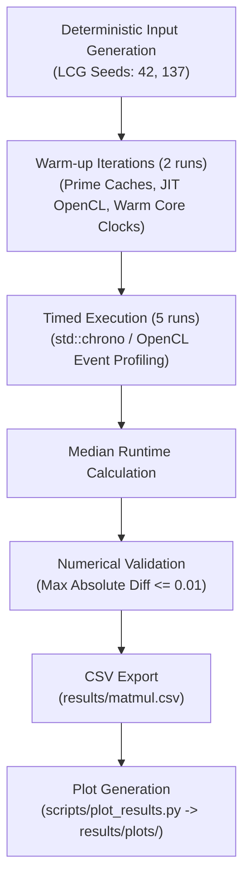
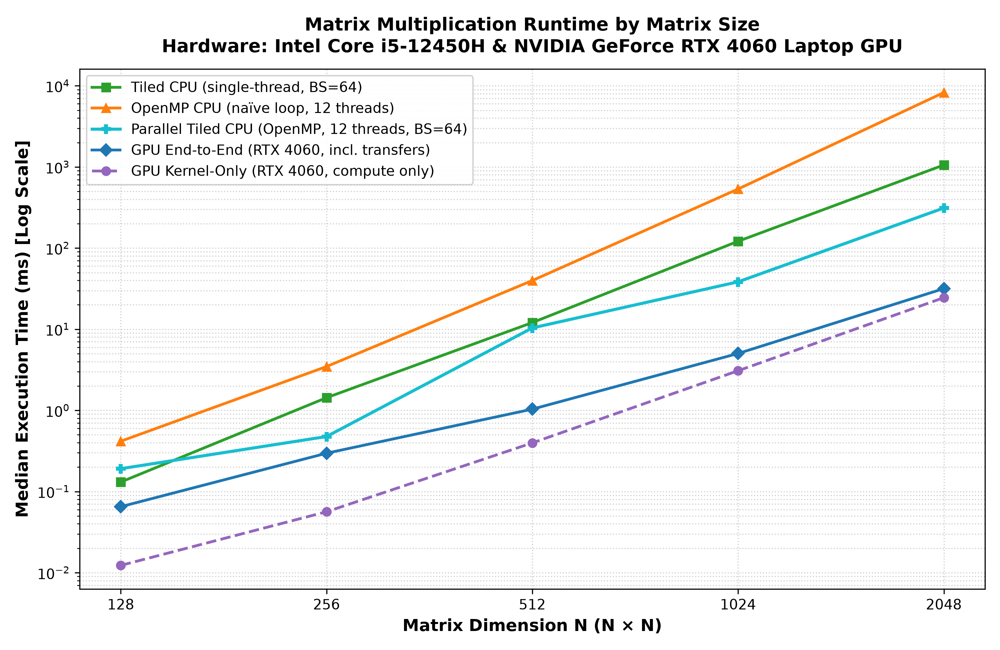
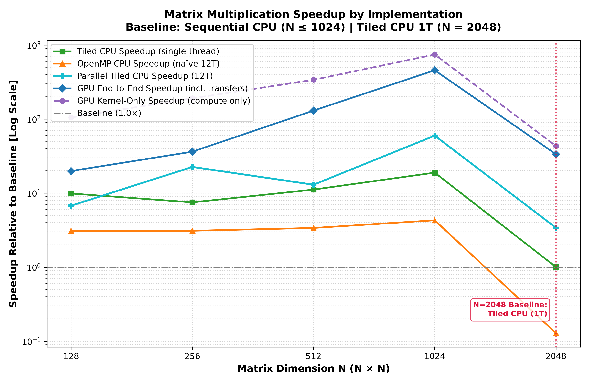
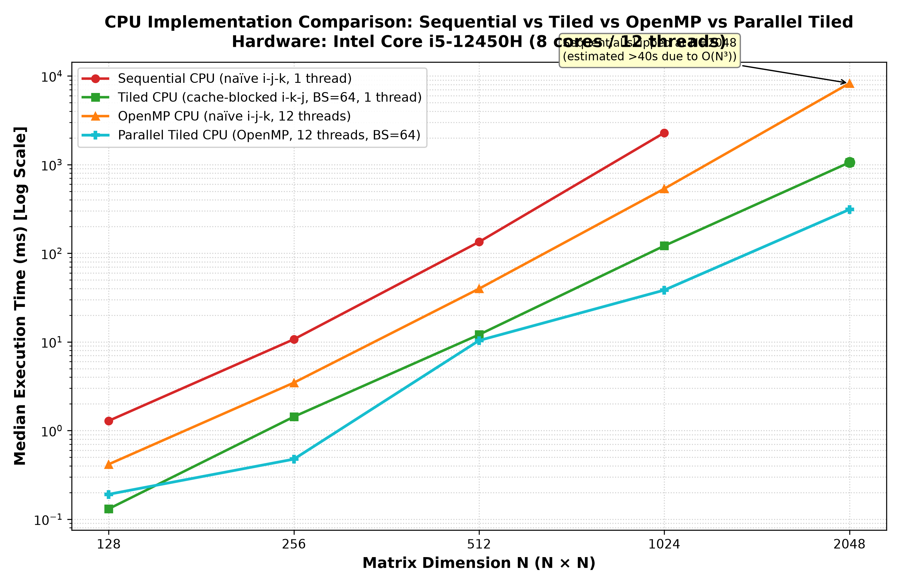

# CPU vs GPU Parallel Computing Benchmark Suite
### High-Performance Matrix Multiplication: Scalar, Cache-Tiled, Multi-Threaded OpenMP, and OpenCL GPU


A modular, extensible C++17 benchmarking suite designed to evaluate and compare the memory, thread, and compute scalability of square single-precision floating-point matrix multiplication ($C = A \times B$) across modern CPU and GPU architectures.

> **Hardware Specification & Environment**:
> - **CPU**: Intel Core i5-12450H (8 physical cores: 4 Performance cores with Hyper-Threading + 4 Efficient cores, 12 hardware threads; 48 KB L1d / P-core, 1.25 MB L2 / P-core, 12 MB shared L3 cache)
> - **GPU**: NVIDIA GeForce RTX 4060 Laptop GPU (8 GB GDDR6 VRAM, 35 W active power limit observed via `nvidia-smi` / 45 W OEM configurable max, 3072 CUDA cores / 24 SMs)
> - **OS & Toolchain**: Ubuntu 22.04 LTS · GCC 11.4.0 (`-O3 -march=native`) · CMake 3.22 · OpenMP 4.5 · OpenCL 3.0 CUDA runtime driver (580.178.04)
>
> **Hardware & Driver Disclosure**: All GPU measurements were executed on an **NVIDIA GeForce RTX 4060 Laptop GPU** via the NVIDIA OpenCL 3.0 runtime. These measurements reflect NVIDIA Ada Lovelace laptop architecture and do **not** claim or represent performance on AMD hardware.

---

## Table of Contents
1. [Key Engineering Insights](#key-engineering-insights)
2. [Benchmark Architecture & Workflow](#benchmark-architecture--workflow)
3. [The Five Implementations](#the-five-implementations)
4. [Memory Locality & Cache Blocking Principles](#memory-locality--cache-blocking-principles)
5. [Performance Audit: Memory Bandwidth vs Thread Scaling](#performance-audit-memory-bandwidth-vs-thread-scaling)
6. [Repository Structure](#repository-structure)
7. [Quick Start & Build Instructions](#quick-start--build-instructions)
8. [Benchmark Methodology](#benchmark-methodology)
9. [Measurement Definitions](#measurement-definitions)
10. [CSV Dataset Schema](#csv-dataset-schema)
11. [Actual Measured Results](#actual-measured-results)
12. [Visualizations](#visualizations)
13. [Interpreting Speedups](#interpreting-speedups)
14. [Limitations & Future Extensions](#limitations--future-extensions)

---

## Key Engineering Insights

- **Cache Locality Outperforms Multi-Threading**: At $N=2048$, the single-threaded cache-tiled CPU (**1,058.16 ms**) is **7.8× faster** than 12-threaded naïve OpenMP (**8,272.15 ms**), illustrating the critical importance of cache blocking over raw thread count when memory access patterns are un-tiled and strided.
- **Combined Cache Blocking & Parallelism**: The Parallel Tiled CPU implementation completes $N=2048$ in **311.95 ms**—a **26.5× speedup** over naïve 12-thread OpenMP ($8,272.15\text{ ms}$) on the identical CPU and thread count, and **3.39× faster** than single-threaded tiled CPU ($1,058.16\text{ ms}$).
- **GPU Compute vs End-to-End Overhead**: At $N=1024$, pure GPU kernel execution requires only **3.08 ms**; the remaining **1.94 ms** of end-to-end runtime ($5.025\text{ ms}$ total, **7.6× faster** than 12-threaded Parallel Tiled CPU at $38.39\text{ ms}$) represents aggregate overhead from host-to-device data movement, runtime dispatch, and synchronization, though the benchmark does not isolate the individual contribution of each component.
- **End-to-End Overhead Amortization**: At $N=128$, end-to-end overhead is approximately 5.4× the kernel execution time ($0.012\text{ ms} \to 0.065\text{ ms}$). By $N=2048$, $O(N^3)$ compute dominates the $O(N^2)$ data movement and dispatch overhead ($24.52\text{ ms}$ kernel vs $31.68\text{ ms}$ end-to-end, a modest 1.29× ratio).
- **Parallel CPU Scaling**: Relative to the single-threaded tiled baseline, Parallel Tiled CPU scaling is workload-dependent: approximately 0.86× as fast at N=512, 3.16× at N=1024, and 3.39× at N=2048.

---

## Benchmark Architecture & Workflow



---

## The Five Implementations

| # | Implementation | File | Language / Model | Key Mechanism |
|---|---|---|---|---|
| 1 | **Sequential CPU** | [`src/cpu/matmul_seq.cpp`](src/cpu/matmul_seq.cpp) | C++17 scalar | Naïve $i\text{-}j\text{-}k$ triple-loop, single-threaded |
| 2 | **Cache-Tiled CPU** | [`src/cpu/matmul_tiled.cpp`](src/cpu/matmul_tiled.cpp) | C++17 scalar | $64 \times 64$ loop blocking, $i\text{-}k\text{-}j$ access order, 1 thread |
| 3 | **OpenMP CPU (Naïve)** | [`src/cpu/matmul_omp.cpp`](src/cpu/matmul_omp.cpp) | OpenMP 4.5 | Outer loop parallelized across 12 threads on naïve algorithm |
| 4 | **Parallel Tiled CPU** | [`src/cpu/matmul_tiled_omp.cpp`](src/cpu/matmul_tiled_omp.cpp) | OpenMP 4.5 + Tiling | $64 \times 64$ loop blocking parallelized across 2D output tiles |
| 5 | **OpenCL GPU** | [`src/gpu/matmul.cl`](src/gpu/matmul.cl), [`src/gpu/matmul_gpu.cpp`](src/gpu/matmul_gpu.cpp) | OpenCL C 1.2 | $16 \times 16$ work-group cooperative local memory tiling on RTX 4060 |

### 1. Sequential CPU (`matmul_seq`)
Standard $i\text{-}j\text{-}k$ triple-loop algorithm. Accesses matrix $A$ along rows and matrix $B$ along columns:
```cpp
for (size_t i = 0; i < N; ++i) {
    for (size_t j = 0; j < N; ++j) {
        float acc = 0.f;
        for (size_t k = 0; k < N; ++k) {
            acc += A[i * N + k] * B[k * N + j]; // Column-stride on B: N * 4 bytes per step
        }
        C[i * N + j] = acc;
    }
}
```

### 2. Cache-Tiled CPU (`matmul_tiled`)
Restructures computation into $BS \times BS$ blocks ($BS=64$ default) with $i \to k \to j$ order:
```cpp
for (size_t ii = 0; ii < N; ii += BS) {
    for (size_t kk = 0; kk < N; kk += BS) {
        for (size_t jj = 0; jj < N; jj += BS) {
            for (size_t i = ii; i < min(ii + BS, N); ++i) {
                for (size_t k = kk; k < min(kk + BS, N); ++k) {
                    float a_ik = A[i * N + k]; // Loaded once into register
                    for (size_t j = jj; j < min(jj + BS, N); ++j) {
                        C[i * N + j] += a_ik * B[k * N + j]; // Unit stride (contiguous)
                    }
                }
            }
        }
    }
}
```

### 3. OpenMP CPU Naïve (`matmul_omp`)
Parallelizes the outer loop of the un-tiled algorithm across 12 hardware threads:
```cpp
#pragma omp parallel for schedule(static)
for (size_t i = 0; i < N; ++i) {
    for (size_t j = 0; j < N; ++j) {
        float acc = 0.f;
        for (size_t k = 0; k < N; ++k) {
            acc += A[i * N + k] * B[k * N + j];
        }
        C[i * N + j] = acc;
    }
}
```

### 4. Parallel Tiled CPU (`matmul_tiled_omp`)
Combines cache blocking with OpenMP multi-threading across 2D output tiles:
```cpp
#pragma omp parallel for collapse(2) schedule(static)
for (size_t ii = 0; ii < N; ii += BS) {
    for (size_t jj = 0; jj < N; jj += BS) {
        // Zero output tile in local cache
        for (size_t i = ii; i < min(ii + BS, N); ++i)
            for (size_t j = jj; j < min(jj + BS, N); ++j)
                C[i * N + j] = 0.f;

        for (size_t kk = 0; kk < N; kk += BS) {
            for (size_t i = ii; i < min(ii + BS, N); ++i) {
                for (size_t k = kk; k < min(kk + BS, N); ++k) {
                    float a_ik = A[i * N + k];
                    for (size_t j = jj; j < min(jj + BS, N); ++j) {
                        C[i * N + j] += a_ik * B[k * N + j];
                    }
                }
            }
        }
    }
}
```
**Race-Condition Freedom**: Each thread exclusively computes tile $C[ii..i\_end, jj..j\_end]$. No two threads ever write to or accumulate into the same element of $C$.

### 5. OpenCL GPU Kernel (`matmul.cl`)
$16 \times 16$ work-items per work-group load tiles cooperatively into on-chip `__local` memory:
```c
#define TILE 16
__kernel void matmul(__global const float* A, __global const float* B,
                     __global float* C, const int N) {
    __local float tileA[TILE][TILE];
    __local float tileB[TILE][TILE];

    int row = get_global_id(1);
    int col = get_global_id(0);
    int lrow = get_local_id(1);
    int lcol = get_local_id(0);
    float acc = 0.0f;
    int num_tiles = (N + TILE - 1) / TILE;

    for (int t = 0; t < num_tiles; ++t) {
        int kA = t * TILE + lcol;
        int kB = t * TILE + lrow;
        tileA[lrow][lcol] = (row < N && kA < N) ? A[row * N + kA] : 0.0f;
        tileB[lrow][lcol] = (kB < N && col < N) ? B[kB * N + col] : 0.0f;
        barrier(CLK_LOCAL_MEM_FENCE);

        for (int k = 0; k < TILE; ++k)
            acc += tileA[lrow][k] * tileB[k][lcol];
        barrier(CLK_LOCAL_MEM_FENCE);
    }
    if (row < N && col < N) C[row * N + col] = acc;
}
```

---

## Memory Locality & Cache Blocking Principles

For an $N \times N$ single-precision matrix in row-major layout:

1. **Naïve $i\text{-}j\text{-}k$ Traversal**:
   - In the inner loop, $B[k \times N + j]$ increments by $N \times 4\text{ bytes}$ per step ($8,192\text{ bytes}$ at $N=2048$).
   - A CPU cache line is 64 bytes (16 floats). Every single access to $B$ lands on a distinct cache line, discarding 15 out of 16 floats (93.75% waste).
2. **Tiled $i\text{-}k\text{-}j$ Traversal**:
   - By hoisting $k$ outside the $j$-loop, the inner loop strides across contiguous memory for both $B[k \times N + j]$ and $C[i \times N + j]$ (stride = 4 bytes).
   - Every float in each fetched 64-byte cache line is used, achieving near 100% cache-line utilization and automatic SIMD vectorization.
   - **Working-Set Footprint**: A single $64 \times 64$ tile of 32-bit floats occupies $16\text{ KB}$. Three such active tiles ($A, B, C$) represent a theoretical working-set estimate of $48\text{ KB}$. While this matches the raw capacity of the Core i5-12450H P-core L1 data cache ($48\text{ KB}$), real-world cache line associativity, stack usage, and operating system overhead mean that portions of the tiles may spill into the unified $1.25\text{ MB}$ L2 cache per core. Crucially, the $48\text{ KB}$ working set remains orders of magnitude smaller than the $1.25\text{ MB}$ L2 and $12\text{ MB}$ L3 caches, substantially reducing DRAM traffic during tile multiplication compared to the un-tiled traversal.

---

## Performance Audit: Memory Bandwidth vs Thread Scaling

### 1. Investigating Naïve OpenMP ($8,272.15\text{ ms}$) vs Tiled CPU ($1,058.16\text{ ms}$) at $N=2048$

At $N=2048$, 12-thread naïve OpenMP requires **8,272.147 ms**, while 1-thread Tiled CPU requires **1,058.156 ms**, and 12-thread Parallel Tiled CPU requires **311.952 ms**.

```
Configuration                     Algorithm    Threads     Time (ms)     Speedup vs Base
-----------------------------------------------------------------------------------------
Sequential CPU (matmul_seq)        Naïve          1        [Skipped]          --
Tiled CPU (matmul_tiled)           Blocked        1         1,058.16      1.00× (ref)
OpenMP CPU (matmul_omp)            Naïve         12         8,272.15      0.13× (vs Tiled)
Parallel Tiled (matmul_tiled_omp)  Blocked       12           311.95      3.39× (vs Tiled)
```

- **Theoretical Memory-Traffic Upper Bound:**
  The naïve access pattern repeatedly traverses column-strided elements of matrix $B$. A hypothetical upper-bound estimate of approximately 550 GB of cache-line traffic illustrates the potential cost if each inner-loop access caused a 64-byte line transfer ($8.589 \times 10^9 \text{ accesses} \times 64\text{ B} \approx 549.75\text{ GB}$). This is an analytical model of potential cache-line requests, not a measurement of actual DRAM traffic; hardware performance counters would be needed to establish actual memory traffic or bandwidth saturation.
- **Cache Capacity and Memory Traffic:**
  At $N=2048$, each single-precision matrix occupies 16 MiB, exceeding the CPU's stated 12 MiB shared L3 cache. This limits the ability to keep an entire matrix resident in L3 and may increase cache misses and memory traffic. Actual DRAM traffic and bandwidth utilization would require hardware-counter measurements to quantify.
- **Algorithmic Disparity:**
  Comparing naïve OpenMP with single-threaded Tiled CPU does **not** isolate the effect of thread count alone, because the two implementations use fundamentally different memory traversal patterns.
- **Parallel CPU Scaling:**
  Relative to the single-threaded tiled implementation, Parallel Tiled CPU is approximately 0.86× as fast at N=512, 3.16× at N=1024, and 3.39× at N=2048. These results show that parallelization benefits depend on workload size; additional profiling is needed to attribute the differences to specific cache or scheduling effects.

### 2. Validation Reference Semantics at $N=2048$
The unoptimized sequential CPU implementation is skipped at $N=2048$ to prevent excessive benchmark execution time (~5 minutes per run).
- At $N \le 1024$, `matmul_tiled` was verified against `matmul_seq` across all runs with error $\Delta < 10^{-4}$ (well within the $0.01$ tolerance).
- At $N=2048$, `matmul_tiled` is treated as a **validated numerical reference** (empirically confirmed to high accuracy at smaller dimensions and mathematically identical in floating-point summation structure) rather than an exact reference. All implementations pass correctness checks against this reference.

---

## Repository Structure

```
cpu-gpu-bench/
├── CMakeLists.txt              # CMake build definition with configurable block size
├── include/
│   ├── matmul.hpp              # Shared Matrix struct, API declarations, MatmulResult
│   └── opencl_utils.hpp       # OpenCL error-checking macros and device helpers
├── src/
│   ├── main.cpp               # Benchmark driver: warm-up, timing, verification, CSV export
│   ├── utils.cpp              # Deterministic LCG fill, max difference, median calculation
│   ├── cpu/
│   │   ├── matmul_seq.cpp     # Naïve sequential CPU baseline
│   │   ├── matmul_tiled.cpp   # Single-threaded cache-tiled CPU baseline
│   │   ├── matmul_omp.cpp     # Multi-threaded naïve OpenMP CPU
│   │   └── matmul_tiled_omp.cpp # Multi-threaded cache-tiled OpenMP CPU
│   └── gpu/
│       ├── matmul.cl          # OpenCL C 1.2 tiled kernel (16x16 local memory)
│       ├── matmul_gpu.cpp     # OpenCL host code, event profiling, memory management
│       └── opencl_utils.cpp   # Device discovery and OpenCL program compiler
├── scripts/
│   └── plot_results.py        # Automated Python plotting script (generates 300-DPI figures)
├── results/
│   ├── matmul.csv             # Raw benchmark output data
│   └── plots/                 # Rendered benchmark visualizations
│       ├── runtime_by_matrix_size.png
│       ├── speedup_comparison.png
│       └── cpu_comparison.png
└── tests/                     # Test harness reserved for unit tests
```

---

## Quick Start & Build Instructions

### Prerequisites (Ubuntu 22.04 LTS)

```bash
sudo apt update
sudo apt install build-essential cmake libgomp1 ocl-icd-opencl-dev opencl-headers python3 python3-pip
python3 -m pip install matplotlib numpy
```

### Configure & Build

```bash
cd ~/cpu-gpu-bench
cmake -B build -DCMAKE_BUILD_TYPE=RelWithDebInfo
cmake --build build --parallel $(nproc)
```

To configure a custom tile block size (e.g., 32):
```bash
cmake -B build -DCMAKE_BUILD_TYPE=RelWithDebInfo -DMATMUL_BLOCK_SIZE=32
cmake --build build --parallel $(nproc)
```

### Running Benchmark & Generating Plots

Always execute from the project root directory so relative paths (`src/gpu/matmul.cl` and `results/matmul.csv`) resolve properly:

```bash
cd ~/cpu-gpu-bench

# 1. Execute the full benchmark suite
./build/matmul_bench

# 2. Generate publication-quality plots from results/matmul.csv
python3 scripts/plot_results.py
```

---

## Benchmark Methodology

For each matrix dimension $N \in \{128, 256, 512, 1024, 2048\}$:

1. **Deterministic Inputs**: Matrices $A$ and $B$ are populated using a linear congruential generator (LCG) with seeds `42` and `137`. The exact same input data is supplied to all five implementations.
2. **Warm-up Iterations**: 2 discarded warm-up runs precede measurement to prime CPU caches, compile OpenCL kernels, and stabilize CPU power states.
3. **Timed Iterations**: 5 measured runs per implementation. The **median** runtime is recorded to minimize OS scheduling noise.
4. **Validation**: Outputs are compared element-wise against the reference matrix. The maximum absolute difference must satisfy $\Delta \le 0.01$.
5. **Speedup Denominator**:
   - $N \le 1024$: Baseline denominator is `seq_ms` (`matmul_seq`).
   - $N = 2048$: Baseline denominator is `tiled_ms` (`matmul_tiled` 1T) because `matmul_seq` is skipped. The CSV column `speedup_base` explicitly records the baseline used.

---

## Measurement Definitions

| Metric | Measured Duration | Excluded Overhead |
|---|---|---|
| `seq_ms` | Single-threaded naïve triple-loop wall-clock | Matrix allocation & initialization |
| `tiled_ms` | Single-threaded tiled loop wall-clock | Matrix allocation & initialization |
| `omp_ms` | OpenMP wall-clock including thread fork/join | OpenMP runtime thread-pool creation |
| `tiled_omp_ms` | Parallel tiled wall-clock including thread fork/join | OpenMP runtime thread-pool creation |
| `gpu_kernel_ms` | Pure GPU execution via OpenCL event profiling (`CL_PROFILING_COMMAND_START` to `END`) | Host-to-device and device-to-host data transfers, host synchronization |
| `gpu_e2e_ms` | Wall-clock from start of buffer write through kernel completion to readback buffer sync | One-time context, program compile, and buffer allocation |

---

## CSV Dataset Schema

File: `results/matmul.csv`

| Column | Type | Description |
|---|---|---|
| `N` | integer | Square matrix dimension ($N \times N$) |
| `seq_ms` | float | Sequential CPU median runtime (ms); `0.000000` when skipped |
| `tiled_ms` | float | Cache-tiled CPU median runtime (ms, 1 thread) |
| `omp_ms` | float | Naïve OpenMP CPU median runtime (ms, 12 threads) |
| `tiled_omp_ms` | float | Parallel Tiled OpenMP CPU median runtime (ms, 12 threads) |
| `gpu_kernel_ms` | float | GPU kernel compute time (ms) via OpenCL event profiling |
| `gpu_e2e_ms` | float | GPU steady-state end-to-end time (ms) including data movement and synchronization |
| `tiled_speedup_vs_seq` | float | Speedup of Tiled CPU relative to baseline (`base_ms / tiled_ms`) |
| `omp_speedup_vs_seq` | float | Speedup of Naïve OpenMP relative to baseline (`base_ms / omp_ms`) |
| `tiled_omp_speedup_vs_seq` | float | Speedup of Parallel Tiled OpenMP relative to baseline (`base_ms / tiled_omp_ms`) |
| `gpu_kernel_speedup_vs_seq` | float | GPU kernel speedup relative to baseline (`base_ms / gpu_kernel_ms`) |
| `gpu_e2e_speedup_vs_seq` | float | GPU end-to-end speedup relative to baseline (`base_ms / gpu_e2e_ms`) |
| `speedup_base` | string | Baseline identifier: `"seq"` ($N \le 1024$) or `"tiled"` ($N=2048$) |
| `seq_correct` | string | Validation status: `"true"` or `"skip"` |
| `tiled_correct` | string | Validation status: `"true"` or `"ref"` |
| `omp_correct` | string | Validation status: `"true"` or `"false"` |
| `tiled_omp_correct` | string | Validation status: `"true"` or `"false"` |
| `gpu_correct` | string | Validation status: `"true"` or `"false"` |

---

## Actual Measured Results

Measured on Intel Core i5-12450H (12 threads) and NVIDIA GeForce RTX 4060 Laptop GPU.
All runs passed validation with $\Delta \le 0.01$.

### Runtimes (median of 5 runs, ms)

| N | Sequential CPU | Tiled CPU (1T) | OpenMP (Naïve 12T) | Parallel Tiled (12T) | GPU Kernel | GPU End-to-End | Validation |
|--:|--:|--:|--:|--:|--:|--:|:---:|
| **128** | 1.289 ms | 0.131 ms | 0.417 ms | **0.191 ms** | 0.012 ms | 0.065 ms | **PASS** |
| **256** | 10.714 ms | 1.434 ms | 3.469 ms | **0.476 ms** | 0.056 ms | 0.297 ms | **PASS** |
| **512** | 134.306 ms | 12.080 ms | 39.841 ms | **10.377 ms** | 0.397 ms | 1.036 ms | **PASS** |
| **1024** | 2,286.924 ms | 121.358 ms | 534.612 ms | **38.390 ms** | 3.080 ms | 5.025 ms | **PASS** |
| **2048** | *Skipped* | 1,058.156 ms | 8,272.147 ms | **311.952 ms** | 24.521 ms | 31.679 ms | **PASS** |

### Speedups (relative to documented baseline)

| N | Baseline Used | Tiled CPU (1T) | OpenMP (Naïve 12T) | Parallel Tiled (12T) | GPU Kernel | GPU End-to-End |
|--:|:---|--:|--:|--:|--:|--:|
| **128** | Sequential CPU | 9.85× | 3.09× | **6.74×** | 104.87× | 19.82× |
| **256** | Sequential CPU | 7.47× | 3.09× | **22.50×** | 190.24× | 36.13× |
| **512** | Sequential CPU | 11.12× | 3.37× | **12.94×** | 338.04× | 129.70× |
| **1024** | Sequential CPU | 18.84× | 4.28× | **59.57×** | 742.46× | 455.11× |
| **2048** | Tiled CPU (1T) | 1.00× (ref) | 0.13× | **3.39×** | 43.15× | 33.40× |

---

## Visualizations

The generated performance figures are stored in `results/plots/`:

### 1. Overall Runtime by Matrix Size

*Log-log plot demonstrating execution times spanning six orders of magnitude, from sub-millisecond GPU compute kernels up to 8-second CPU runs.*

### 2. Speedup Relative to Documented Baseline

*Speedup curves across all implementations with an explicit transition indicator at $N=2048$.*

### 3. CPU Implementation Comparison

*Direct comparison of Sequential, Single-Threaded Tiled, Naïve OpenMP, and Parallel Tiled CPU implementations.*

---

## Interpreting Speedups

1. **Sequential Baseline Effect**:
   The sequential baseline is an un-vectorized, un-tiled triple loop. Comparing advanced accelerators against an unoptimized sequential baseline produces large speedups (e.g., **59.57×** for parallel tiled CPU and **455.11×** for GPU end-to-end at $N=1024$). When compared against the **single-threaded cache-tiled CPU baseline**, the GPU end-to-end speedup is **24.2× at $N=1024$** ($121.36\text{ ms} / 5.025\text{ ms}$) and **33.4× at $N=2048$** ($1,058.16\text{ ms} / 31.68\text{ ms}$).
2. **End-to-End GPU Overhead**:
   At N=128, GPU kernel time is 0.012 ms while end-to-end time is 0.065 ms. At N=2048, the respective times are 24.521 ms and 31.679 ms. The difference includes overhead beyond kernel execution; this benchmark does not independently measure each transfer or synchronization component.
3. **Parallel CPU Scaling**:
   Relative to the single-threaded tiled implementation, Parallel Tiled CPU is approximately 0.86× as fast at N=512, 3.16× at N=1024, and 3.39× at N=2048. These results show that parallelization benefits depend on workload size; additional profiling is needed to attribute the differences to specific cache or scheduling effects.

---

## Limitations & Future Extensions

1. **Explicit SIMD Vectorization**: CPU implementations rely on GCC `-O3` auto-vectorization. Future iterations could integrate explicit AVX2/FMA intrinsics.
2. **Tile Size Tuning**: Block sizes ($BS=64$ for CPU, $16 \times 16$ for GPU) are fixed defaults. Auto-tuning across cache sizes could yield further throughput gains.
3. **Core Heterogeneity**: The Intel Core i5-12450H pairs 4 Performance cores with 4 Efficient cores. OpenMP static scheduling distributes equal block counts across threads regardless of core speed. Dynamic scheduling or thread pinning could balance heterogeneous execution.
4. **Hardware Specificity**: Measurements reflect NVIDIA Ada Lovelace laptop architecture and the NVIDIA OpenCL 3.0 driver. AMD ROCm or Intel oneAPI architectures will exhibit different scaling characteristics.
